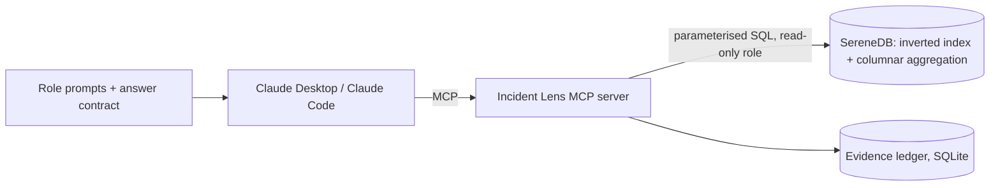

# Incident Lens

**An MCP server that gives Claude role-aware, evidence-backed tools over the BGL and OpenStack logs in SereneDB.**
The database searches and calculates; Claude explains; every number traces to a query that actually ran.

> *One corpus, three roles, three kinds of evidence, and a ledger that proves every claim.*

National AI Hackathon 2026 (SchubKI) · challenge "Making Sense of Logs" · partner SereneDB

## What it does

| Role | Question | Tools Claude picks | Next step it gives |
|---|---|---|---|
| Engineer | What failed, where, what happened just before and after? | `search_logs` → `nearby_events` → `count_by`(node) | one concrete diagnostic check |
| Team lead | Which problems recur, how often, which teams? | `count_by`(team/component) → `trend` → `episodes` → `recurring_patterns` | what to investigate first, and who owns it |
| Manager | What deserves attention first? | `corpus_overview` → `recurring_patterns` → `trend` → `episodes` | short ranked priorities, **no invented impact** |

Four design bets: (1) tool descriptions written as specs, with limits and "do not use for"; (2) an **evidence ledger** - every tool call is stored (SQL, filters, scope, counts, truncation, result) and returns an `evidence_id`; (3) **entries vs episodes** - bursts are collapsed with a stated gap rule so a count of lines is never presented as a count of incidents; (4) a **four-block answer contract** (Observed / Hypotheses / Recommended checks / Unknown) delivered as MCP prompts per role.



## Quickstart (clean checkout)

Requires Python 3.10+, `curl`, `unzip`. The script starts SereneDB itself either way: natively on Linux x86_64, or via the official Docker image everywhere else (macOS, Windows, Linux ARM) - just have Docker installed and running. If neither is available, install SereneDB from <https://serenedb.com/download> and start it on `127.0.0.1:7890` first.

```bash
git clone <this repo> && cd incident-lens
./scripts/setup.sh --sample      # seconds: 2,000-line Loghub samples, good for trying everything
./scripts/setup.sh               # full corpus: downloads BGL (709 MB) + OpenStack (58 MB) from Zenodo, parses, loads, indexes
pytest -q --asyncio-mode=auto tests    # needs the --sample load (15 tests, numbers checked against plain SQL)
python tests/stdio_smoke.py            # spawns the server like Claude does and calls a tool
```

`setup.sh` = start SereneDB → download (`curl -L ...?download=1`) → `prep/parse_*.py` (raw log → Parquet) → `scripts/load.py` (`sql/schema.sql`, `ownership.sql`, `indexes.sql`, `readonly_role.sql`; prints load and index-build timings).

Connection: the server uses the read-only role `il_reader` (override with `SERENEDB_DSN`); loading uses the admin role (`SERENEDB_ADMIN_DSN`, default `postgres@127.0.0.1:7890`). SereneDB speaks the Postgres wire protocol, so `psql -h 127.0.0.1 -p 7890 -U postgres` works too.

## Connect Claude

Use absolute paths (`run_server.py` works from any directory).

**Claude Code**
```bash
claude mcp add incident-lens -- python3 /ABS/PATH/incident-lens/run_server.py
```
**Claude Desktop** - add to `claude_desktop_config.json`:
```json
{ "mcpServers": { "incident-lens": { "command": "python3", "args": ["/ABS/PATH/incident-lens/run_server.py"] } } }
```
Optional HTTP transport: `python3 run_server.py --http`.

Then start with a role prompt (`engineer_investigation`, `lead_review`, `manager_priorities` appear as MCP prompts) or just ask, e.g. *"Find 'parity error' in BGL and show what happened around the first hit."* Terminal fallback that calls the same tools through the API: `python cli/ask.py --role lead "Which teams had the most severe entries?"`.

## Tools

Full generated reference with every input and description: [`docs/TOOLS.md`](docs/TOOLS.md).

| Tool | Roles | Returns |
|---|---|---|
| `corpus_overview` | all | exact whole-corpus counts: rows, span, by level / component / team (+ BGL alert categories, OpenStack anomaly labels) |
| `search_logs` | engineer | ≤`limit` highlighted rows (a sample) + `total_matches`, first/last seen, top nodes, by-level over **all** matches; modes terms / phrase / any / fuzzy |
| `nearby_events` | engineer | events around one entry (same node / same request), anchor flagged, truncated flag |
| `count_by` | lead, manager | exact counts by team / component / level / node / alert / template / service / status |
| `trend` | lead, manager | counts per hour/day/week, `partial_bucket` flags, growth vs the preceding period of equal length |
| `episodes` | all | entries vs episodes, largest episodes, the gap rule used |
| `recurring_patterns` | lead, manager | top message templates with counts, spread, first/last seen, new-vs-recurring |
| `latency_summary` | engineer, lead | OpenStack request count, p50/p95/p99, ERROR rate, WARNING rate, HTTP 5xx rate |
| `team_ownership` | lead, manager | component → team (fictional) |
| `get_evidence` | all | replay any ledger entry: tool, arguments, exact SQL, result |

Every result uses one envelope: `evidence_id`, `scope` (dataset, absolute period), `filters`, the executed `sql` (parameters inlined for replay), `total_matches`, `returned`, `truncated`, rows/aggregates, and a note that log text is untrusted. Guardrails: parameterised queries only, read-only DB role, default 20 / hard cap 100 rows, 30 s statement timeout, no free-form SQL from the agent. Bad input (an unknown `group_by`, a malformed date, an unknown `evidence_id`) comes back to Claude as a readable error naming the problem, not a bare "tool failed" - the MCP SDK strips detail from *unexpected* exceptions by design, so every deliberate input check raises `ToolError` instead of a plain exception.

## Data, schema, ownership

Datasets: **BGL** (Blue Gene/L RAS logs, 4.7M lines, 214 days) and **OpenStack** (207,820 nova lines, request ids, inline latency). Tables `bgl_logs`, `openstack_logs`, `ownership`; inverted indexes `bgl_idx`, `os_idx` over message text with a lower-case, non-stemming dictionary (identifiers and error codes stay intact). The index also carries `ts`, level, component, node/service so filters run inside the scan.

The `template` column is derived by `prep/templating.py` (numbers, ids, hosts → `<*>`); it approximates message types and is **not** Loghub's labelled templates.

**Ownership table is fictional**, invented for this challenge (`sql/ownership.sql`): BGL by `component` - KERNEL → Kernel & Runtime; APP → Application Support; HARDWARE → Hardware Reliability; LINKCARD, SERV_NET → Interconnect & Network; MMCS, CMCS, BGLMASTER, DISCOVERY → Control Plane; MONITOR, DIAGS → Monitoring & Diagnostics. OpenStack by `service` - nova-api → API Platform; nova-compute → Compute; nova-scheduler → Scheduling. `load.py` warns about any component without an owner.

## Answer contract and counting rules

Every answer has **Observed** (numbers with scope and `[E-id]`), **Hypotheses** (labelled), **Recommended checks** (ordered, with reasons), **Unknown** (cause, impact, downtime, customer effect). Matching entries are not incidents; truncated rows never establish frequency; periods are absolute dates; no financial loss, downtime or customer impact is ever invented. `eval/verify_answer.py` checks that every cited id exists, that every number next to an id appears in that ledger entry, and flags uncited numbers.

## Evaluation

`eval/golden.yaml` holds 15 golden questions (5 engineer, 5 lead, 5 manager, including refusal, truncation and prompt-injection cases); `eval/ground_truth.py` computes reference numbers with plain SQL; `eval/run.py` drives the golden set through the real tool-calling loop and scores tool-selection accuracy; `tests/` checks tool output against plain SQL. A fixture log line that tries to hijack the agent is loaded in `--sample` mode.

**Scale:** `eval/benchmark.py` times every tool against the full 4.7M + 207K-row corpus (20 calls each, cold call excluded) - results and a root-cause analysis of the one slow outlier (relevance-ranked search combined with a time filter) are in [`eval/benchmark_results.md`](eval/benchmark_results.md).

**Grounded vs. ungrounded:** [`investigation/llm_vs_incident_lens.md`](investigation/llm_vs_incident_lens.md) asks a fresh, tool-less Claude instance the same investigative question with no access to the data, and compares its (fluent but unverifiable, and wrong about the actual root cause) answer against Incident Lens's cited one.

## Status and known limitations (read this)

What has been executed, on the **full real corpus** (SereneDB 26.10.1; macOS arm64 via the official Docker image - `scripts/start_serenedb.sh` falls back to Docker automatically when the native Linux binary isn't available):

| Check | Status |
|---|---|
| Full load: 4,747,945 BGL rows + 207,812 OpenStack rows from the real Zenodo archives, parsed, loaded, indexed | **executed** - tables loaded in 3.6-9.2 s, inverted indexes built + refreshed in 5.9-9.6 s across repeated runs |
| Schema, inverted index, phrase/terms/any/fuzzy search, BM25 + highlight, window functions, percentiles, `date_trunc`, read-only role | executed, working, at full scale |
| All 10 tools, 15 pytest tests against plain-SQL ground truth, real stdio MCP round-trip | executed, passing (against both the 2k samples and the full corpus) |
| Worked investigation (`investigation/worked_investigation.md`) | **executed against the full corpus** - a real recurring BGL failure pattern (ciod job-launch failures, 1,024 nodes, 52,763 episodes) walked through all three roles with real evidence ids; checked with `eval/verify_answer.py` |
| `eval/run.py` golden-set runner, `cli/ask.py` Anthropic API loop | built and dry-run tested; **not exercised against the live API** (no key in this environment) - `--dry-run` works end to end |

**Bugs found and fixed by testing against the full real data instead of trusting the code against the 2k samples alone:** the OpenStack anomaly-label parser was joining the wrong id type (instance ids against request ids) and silently labelling almost nothing as anomalous; the BGL parser dropped lines with no message text and mis-shifted fields on the small number of lines with no specific node, undercounting FATAL entries; a handful of lines carry literal binary corruption in the raw file itself and are now detected and skipped rather than guessed at; the stdio smoke test wasn't forwarding `SERENEDB_DSN` to the spawned server, matching how a real MCP client config works.

Other limitations: episodes are a counting convention (gap default 300 s, per node/service); OpenStack latency exists only on nova-api request lines; the logs do not establish root cause, downtime or customer impact; priority scores rank observed frequency and spread only.

## Citations

Zhu et al., *Loghub: A Large Collection of System Log Datasets for AI-driven Log Analytics*, ISSRE 2023. For BGL also: Oliner and Stearley, *What Supercomputers Say: A Study of Five System Logs*, DSN 2007. Loghub data is research-use; cite when reusing.
