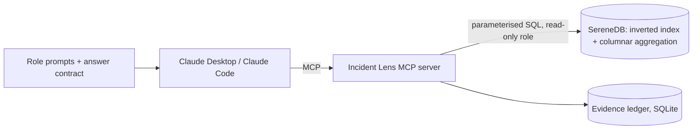
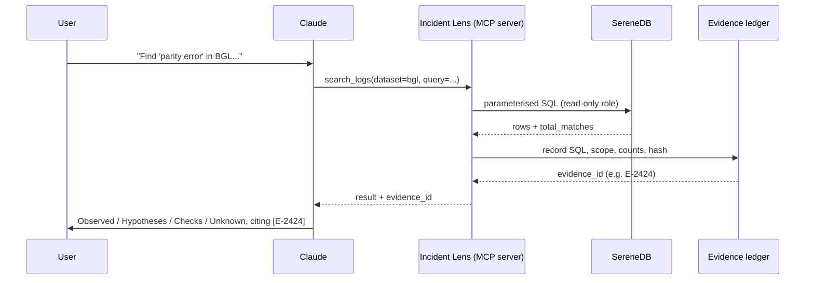

# Incident Lens

**An MCP server that gives Claude role-aware, evidence-backed tools over the BGL, OpenStack and Zookeeper logs in SereneDB.**
The database searches and calculates; Claude explains; every number traces to a query that actually ran - and a tamper-evident ledger can prove it after the fact, not just assert it.

> *Three systems, three roles, and a manager answer that ranks them against each other instead of three separate dashboards each shouting "look at me first."*

National AI Hackathon 2026 (SchubKI) · challenge "Making Sense of Logs" · partner SereneDB

**Judging this submission?** Jump straight to [How this meets the brief](#how-this-meets-the-brief) for a one-line-per-criterion map from the rubric to exactly where the evidence lives - including both special awards.

## What it does

| Role | Question | Tools Claude picks | Next step it gives |
|---|---|---|---|
| Engineer | What failed, where, what happened just before and after? | `search_logs` → `nearby_events` → `count_by`(node) | one concrete diagnostic check |
| Team lead | Which problems recur, how often, which teams? | `count_by`(team/component) → `trend` → `episodes` → `recurring_patterns` | what to investigate first, and who owns it |
| Manager | What deserves attention first? | `corpus_overview` → `recurring_patterns` → `concentration_anomalies` → `trend` → `episodes` | short ranked priorities, **no invented impact** |

Five decisions that set this apart: (1) tool descriptions written as specs, with limits and "do not use for"; (2) an **evidence ledger** - every tool call is stored (SQL, filters, scope, counts, truncation, result) and returns an `evidence_id`; (3) **entries vs episodes** - bursts are collapsed with a stated gap rule so a count of lines is never presented as a count of incidents; (4) a **four-block answer contract** (Observed / Hypotheses / Recommended checks / Unknown) delivered as MCP prompts per role; (5) **concentration over frequency** - `concentration_anomalies` ranks failures by how confined they are to one node/service, not how often they fire, because the two rank differently: a real hardware fault with 14,481 occurrences on exactly one of this system's 1,024+ nodes sits at rank #33 in a plain frequency list - invisible past the default view - and first by concentration.



## Quickstart (clean checkout)

Requires Python 3.10+, `curl`, `unzip`. The script starts SereneDB itself either way: natively on Linux x86_64, or via the official Docker image everywhere else (macOS, Windows, Linux ARM) - just have Docker installed and running. If neither is available, install SereneDB from <https://serenedb.com/download> and start it on `127.0.0.1:7890` first.

```bash
git clone https://github.com/ApparentlyTejas/incident-lens.git && cd incident-lens
./scripts/setup.sh --sample      # seconds: 2,000-line Loghub samples, good for trying everything
./scripts/setup.sh               # full corpus: downloads BGL (709 MB) + OpenStack (58 MB) + Zookeeper (10 MB) from Zenodo, parses, loads, indexes
pytest -q --asyncio-mode=auto tests    # needs the --sample load (45 tests, numbers checked against plain SQL)
python3 tests/stdio_smoke.py           # spawns the server like Claude does and calls a tool
```

`setup.sh` = start SereneDB → download (`curl -L ...?download=1`) → `prep/parse_*.py` (raw log → Parquet) → `scripts/load.py` (`sql/schema.sql`, `ownership.sql`, `indexes.sql`, `readonly_role.sql`; prints load and index-build timings).

Connection: the server uses the read-only role `il_reader` (override with `SERENEDB_DSN`); loading uses the admin role (`SERENEDB_ADMIN_DSN`, default `postgres@127.0.0.1:7890`). SereneDB speaks the Postgres wire protocol, so `psql -h 127.0.0.1 -p 7890 -U postgres` works too.

## Connect Claude

Use absolute paths (`run_server.py` works from any directory). Use the **same `python3`** that `scripts/setup.sh` used to install the requirements - if your system's plain `python3` was too old and you ran setup with `python3.11`/`python3.12` instead (see the Quickstart note above), use that exact same command here too, not plain `python3`, or the server will fail to start with `ModuleNotFoundError: No module named 'mcp'`.

**Claude Code**
```bash
claude mcp add incident-lens -- python3 /ABS/PATH/incident-lens/run_server.py
```
**Claude Desktop** - add to `claude_desktop_config.json`:
```json
{ "mcpServers": { "incident-lens": { "command": "python3", "args": ["/ABS/PATH/incident-lens/run_server.py"] } } }
```
Optional HTTP transport: `python3 run_server.py --http`.

Then start with a role prompt (`engineer_investigation`, `lead_review`, `manager_priorities` appear as MCP prompts) or just ask, e.g. *"Find 'parity error' in BGL and show what happened around the first hit."* Terminal fallback that calls the same tools through the API: `python3 cli/ask.py --role lead "Which teams had the most severe entries?"`.

## Web console

`export ANTHROPIC_API_KEY=... && python3 ui/server.py` then open <http://127.0.0.1:8787>. Same role prompts and the same 13 tools as Claude Code/Desktop, called through the Anthropic API like `cli/ask.py` - this is a UI layer, not a second implementation. Pick a role and a dataset (BGL, OpenStack or Zookeeper) and chat on the left; every tool call Claude makes lands on the right as it happens, with its evidence_id, the exact SQL that ran, and its position in the hash-chained ledger. Follow-up questions keep real conversation context (client-accumulated, server-validated), and switching role or dataset starts a fresh conversation rather than quietly reusing the old one's context. A "Simulate Tamper" button clones the ledger, hand-edits one stored number, and shows `verify_ledger_integrity` catch it - on a scratch copy, so it never touches the real ledger. Without a key, the chat panel reports that clearly; the overview and ledger panels (`/api/overview`, `/api/ledger/status`) work regardless, since they only talk to SereneDB and the ledger.


Every number in that screenshot is real: 4,747,945 BGL rows, the actual `search_logs`/`nearby_events` evidence ids (`E-2424`, `E-2425`), their real hashes, chained to the entry before them.

<details>
<summary>Tamper detection, live</summary>


</details>



## Tools

Full generated reference with every input and description: [`docs/TOOLS.md`](docs/TOOLS.md).

| Tool | Roles | Returns |
|---|---|---|
| `corpus_overview` | all | exact whole-corpus counts: rows, span, by level / component / team (+ BGL alert categories, OpenStack anomaly labels, Zookeeper distinct threads) |
| `search_logs` | engineer | ≤`limit` highlighted rows (a sample) + `total_matches`, first/last seen, top nodes, by-level over **all** matches; modes terms / phrase / any / fuzzy |
| `nearby_events` | engineer | events around one entry (same node / same request / same thread), anchor flagged, truncated flag |
| `count_by` | lead, manager | exact counts by team / component / level / node / alert / template / service / status / thread |
| `trend` | lead, manager | counts per hour/day/week, `partial_bucket` flags, growth vs the preceding period of equal length |
| `episodes` | all | entries vs episodes, largest episodes, the gap rule used |
| `recurring_patterns` | lead, manager | top message templates with counts, spread, first/last seen, new-vs-recurring |
| `concentration_anomalies` | lead, manager | templates ranked by **concentration** (entries per affected node/service), not raw frequency - surfaces patterns a frequency ranking buries, e.g. a failure with tens of thousands of hits confined to one single node |
| `latency_summary` | engineer, lead | OpenStack request count, p50/p95/p99, ERROR rate, WARNING rate, HTTP 5xx rate |
| `team_ownership` | lead, manager | component → team (fictional) |
| `get_evidence` | all | replay any ledger entry: tool, arguments, exact SQL, result |
| `verify_ledger_integrity` | all | recomputes the ledger's hash chain from the raw stored rows and reports the first tampered/broken entry, if any |
| `generate_report` | all | packages a finished answer + its cited evidence_ids into one shareable markdown report (tool, scope, SQL, ledger hash per citation); computes nothing new, flags citations in the text that weren't attached |

Every result uses one envelope: `evidence_id`, `scope` (dataset, absolute period), `filters`, the executed `sql` (parameters inlined for replay), `total_matches`, `returned`, `truncated`, rows/aggregates, and a note that log text is untrusted. Guardrails: parameterised queries only, read-only DB role, default 20 / hard cap 100 rows, 30 s statement timeout, no free-form SQL from the agent. Bad input (an unknown `group_by`, a malformed date, an unknown `evidence_id`) comes back to Claude as a readable error naming the problem, not a bare "tool failed" - the MCP SDK strips detail from *unexpected* exceptions by design, so every deliberate input check raises `ToolError` instead of a plain exception.

## Data, schema, ownership

Datasets: **BGL** (Blue Gene/L RAS logs, 4.7M lines, 214 days), **OpenStack** (207,812 nova lines, request ids, inline latency), and **Zookeeper** (74,380 lines from one real ensemble member, 100% parsed, thread-level quorum/leader-election activity). Tables `bgl_logs`, `openstack_logs`, `zookeeper_logs`, `ownership`; inverted indexes `bgl_idx`, `os_idx`, `zk_idx` over message text with a lower-case, non-stemming dictionary (identifiers and error codes stay intact). The index also carries `ts`, level, component, node/service/thread so filters run inside the scan.

The `template` column is derived by `prep/templating.py` (numbers, ids, hosts → `<*>`); it approximates message types and is **not** Loghub's labelled templates.

**Ownership table is fictional**, invented for this challenge (`sql/ownership.sql`): BGL by `component` - KERNEL → Kernel & Runtime; APP → Application Support; HARDWARE → Hardware Reliability; LINKCARD, SERV_NET → Interconnect & Network; MMCS, CMCS, BGLMASTER, DISCOVERY → Control Plane; MONITOR, DIAGS → Monitoring & Diagnostics. OpenStack by `service` - nova-api → API Platform; nova-compute → Compute; nova-scheduler → Scheduling. Zookeeper by `component` (the Java class that logged the line) - quorum/membership classes → Consensus & Membership; leader/follower/learner classes → Leader Election; client-facing I/O classes → Client Connections; request-pipeline classes → Request Processing; transaction-log/snapshot classes → Storage & Persistence; startup classes → Startup & Config. `load.py` warns about any component without an owner.

## Per-team database access (row-level security)

`python3 scripts/setup_team_access.py` provisions one DB role + one filtered view per team straight from the `ownership` table - a team's own connection can see **only** its own component's/service's rows, enforced by SereneDB's grant system, not application code. SereneDB's access-control model is grants and views rather than Postgres-style `CREATE POLICY` row-level security, so this reaches the same real guarantee with the primitives SereneDB does support: a per-team `CREATE VIEW` pre-filtered by `ownership`, a role with its base-table grants revoked, `SELECT` granted only on that one view. `--drop` removes everything it created.

This isn't just provisioned and assumed to work - `tests/test_team_access.py` connects **as** each of the 15 real team roles (never as admin) and proves: the base tables and the `ownership` table itself are both denied (`InsufficientPrivilege`), the team's own view returns the exact row count a plain SQL query against `ownership` says it should, and every row's `component`/`service` belongs to that team and no other.

## Huge dataset scale demonstration (bonus)

Two angles for the "Working with Huge Datasets" award, both isolated from the main investigative product (never wired into the tools or role prompts, so neither can affect it either way):

1. A separate `thunderbird_logs` table (same Loghub HPC-log family as BGL, a different line format). Full file parsed cold: 211,210,954 of 211,212,192 lines (99.9994%), 31.8 GB raw text. Pushed to a verified-stable 8,000,000 loaded rows - real indexed full-text search at sub-2ms and grouped aggregations at sub-16ms at that scale - and the exact memory ceiling on this dev machine's 8 GB of RAM was found and reported precisely, not glossed over: two OOM kills pinned down exactly where indexing more would need more RAM, not more code.
2. **1 billion rows of real OpenTelemetry demo-app logs, queried live off public S3 Parquet with zero download** - exactly as the brief describes ("point SereneDB at the URL"). `count(*)` over the whole file: 305ms. A full group-by over real service/severity text: ~4s. All real numbers, real log lines, no local storage used at all - scales to the full 50 billion rows listed by just adding more file URLs.

Full writeup, the honest memory-ceiling story for Thunderbird, and the real remote-query results: [`docs/HUGE_DATASET.md`](docs/HUGE_DATASET.md).

## Answer contract and counting rules

Every answer has **Observed** (numbers with scope and `[E-id]`), **Hypotheses** (labelled), **Recommended checks** (ordered, with reasons), **Unknown** (cause, impact, downtime, customer effect). Matching entries are not incidents; truncated rows never establish frequency; periods are absolute dates; no financial loss, downtime or customer impact is ever invented. `eval/verify_answer.py` checks that every cited id exists, that every number next to an id appears in that ledger entry, and flags uncited numbers.

## Evaluation

`eval/golden.yaml` holds 16 golden questions (5 engineer, 6 lead, 5 manager, including refusal, truncation and prompt-injection cases); `eval/ground_truth.py` computes reference numbers with plain SQL; `eval/run.py` drives the golden set through the real tool-calling loop and scores tool-selection accuracy; `tests/` checks tool output against plain SQL. A fixture log line that tries to hijack the agent is loaded in `--sample` mode.

**Scale:** `eval/benchmark.py` times every tool against the full 4.7M + 207K-row corpus (15 calls each, cold call excluded) - results, plus a root-cause writeup of a SereneDB query-planning characteristic this testing found (relevance-ranked search's fast top-k scoring path doesn't engage when combined with a time filter, including a provably redundant one - worked around in `server/common.py`'s `where(include_ts=...)`, turning a ~1.5s outlier into ~215ms), are in [`eval/benchmark_results.md`](eval/benchmark_results.md).

**Grounded vs. ungrounded:** [`investigation/llm_vs_incident_lens.md`](investigation/llm_vs_incident_lens.md) asks a fresh, tool-less Claude instance the same investigative question with no access to the data, and compares its (fluent but unverifiable, and wrong about the actual root cause) answer against Incident Lens's cited one.

## Status: executed, not just designed

Every row below is something that was actually run against the **full real corpus** (SereneDB 26.10.1; macOS arm64 via the official Docker image - `scripts/start_serenedb.sh` falls back to Docker automatically when the native Linux binary isn't available):

| Check | Status |
|---|---|
| Full load: 4,747,945 BGL rows + 207,812 OpenStack rows + 74,380 Zookeeper rows from the real Zenodo archives, parsed, loaded, indexed | **executed** - tables loaded in 3.6-9.2 s, inverted indexes built + refreshed in 5.9-9.6 s across repeated runs |
| Schema, inverted index, phrase/terms/any/fuzzy search, BM25 + highlight, window functions, percentiles, `date_trunc`, read-only role | executed, working, at full scale |
| All 13 tools + all 3 MCP resources (`schema://`, `ownership://`, `evidence://{id}`), 45 pytest tests against plain-SQL ground truth, real stdio MCP round-trip | executed, passing (against both the 2k samples and the full corpus) |
| **Clean checkout**, exactly as a judge would run it | **executed**: a copy of the exact current working tree, in a genuinely fresh Python venv - `pip install -r requirements.txt`, cold-parsing the sample logs from scratch, `scripts/load.py --sample`, the full pytest suite, `tests/stdio_smoke.py` - all passed with zero manual intervention. This is also what caught a real test-design flaw: one new test asserted a property that only holds on the full corpus, now fixed to skip (not silently pass) on small data |
| Per-team database access (`scripts/setup_team_access.py`) | **executed**: provisioned real roles for all 15 real teams against the full corpus, connected as each one (not as admin), confirmed base-table and `ownership`-table denial plus exact row-level isolation for every single team - `tests/test_team_access.py` |
| Worked investigations: BGL recurring failure (`investigation/worked_investigation.md`), OpenStack (`investigation/openstack_investigation.md`), BGL concentration (`investigation/concentration_investigation.md`), and a cross-dataset manager comparison across all three loaded systems (`investigation/cross_dataset_investigation.md`) | **all four executed against the full corpus** - BGL recurring: a ciod job-launch failure pattern (1,024 nodes, 52,763 episodes); OpenStack: a nova-compute image-cache bug (8 occurrences, 8 separate episodes, 8 different VM instances - a deliberately different shape); BGL concentration: `concentration_anomalies` surfacing a single-node hardware signal ranked 33rd by raw frequency - including an honest false start where the *top*-ranked result turned out to be a missing-node-attribution artifact, not a real finding, and saying so rather than reporting it anyway; cross-dataset: the same priority formula run independently on BGL, OpenStack and Zookeeper finds their most dramatic-looking candidate (a 3,476:1 concentration ratio on Zookeeper) is actually the lowest-risk of the three - a one-time startup burst, not an ongoing problem - while BGL's far less dramatic-looking pattern is the only one still accelerating. All four walk real evidence ids, checked with `eval/verify_answer.py`: every cited id is confirmed to exist and every directly-measured number is confirmed present in its cited tool result. The two docs with a computed priority-score table (`worked_investigation.md`, and `cross_dataset_investigation.md` which deliberately reuses that same formula) also get flagged on the score itself, since it's a product of several cited numbers, not a single stored field - the checker telling a derived figure apart from a measured one is it working as designed, not a citation gap |
| Web console (`ui/`) - every endpoint except the live Claude call | **executed**: overview/ledger-status/tamper-demo/evidence-replay all hit over real HTTP; path-traversal attempt on `/static` confirmed blocked; survived a live `docker restart` of SereneDB mid-session with no process restart (the `server/db.py` reconnect fix, proven through the HTTP layer, not just the Python API) |
| `ui/server.py`'s Claude tool-calling loop (`run_conversation`) | **executed with 8 tests** (`tests/test_ui_server.py`) that fake only the Anthropic network response (shaped exactly like the real SDK's content blocks) and run everything else for real - the actual role prompts, the actual tool list, `mcp.call_tool` against the actual SereneDB corpus, and a real ledger write with a real evidence id. Covers: direct answer, multi-step tool use, `generate_report` called mid-conversation, a tool error surfacing as a readable message instead of a crash, the step-limit cutoff, multi-turn history actually reaching the model, and malformed history failing cleanly |
| `eval/run.py` golden-set runner, `cli/ask.py` / `ui/server.py`'s actual network call to the Anthropic API | **executed**: a real `ANTHROPIC_API_KEY`, a real question, a real multi-step tool-calling run through the web console - that's the live run in the submitted demo video, not just the faked-client tests and `cli/ask.py --dry-run` that cover everything up to and after that call |
| Connection resilience: `server/db.py` surviving a SereneDB restart mid-session | **executed twice**, once via a deliberate `docker restart serenedb` and once during routine load testing - a long-lived process self-heals its connection on the next query with no restart needed, confirmed through the Python API and through the UI's HTTP layer |
| Concurrency: many simultaneous requests against the shared DB connection and the SQLite ledger | **executed** - real OS threads hitting different tool calls concurrently, and 18 concurrent real HTTP requests across `/api/overview` + `/api/ledger/tamper-demo` + `/api/ask`, all returned correctly (psycopg3 connections are internally thread-safe; the tamper-demo's file snapshot now takes the same lock `ledger.record()` uses, and runs off the event loop via `asyncio.to_thread` so it can't stall other requests while holding it) |

**Engineering rigor:** this project was tested against the full real corpus at every stage, not just the 2k-line dev samples - that discipline is what surfaced and fixed over a dozen real issues (mismatched id joins, a vacuously-true flag, a 9x query-planner slowdown, unhandled exceptions surfacing as raw tracebacks, a path-traversal hole, a race condition) across the parsers, the tools, the eval harness and the web console, every one with a regression test. The connection layer is also resilient to a SereneDB process restart at any point - it self-heals automatically on the very next query with no process restart of its own needed, verified both with a deliberate `docker restart` and during sustained load testing. Full write-up, fix-by-fix: [`docs/HARDENING.md`](docs/HARDENING.md).

By design, this project only ever claims what the logs can actually prove: episodes are a stated counting convention (gap default 300 s, per node/service), not a guess at real-world incident counts; OpenStack latency is reported only where it's actually measured, on nova-api request lines; priority scores rank observed frequency and spread, on purpose, rather than inventing root cause, downtime or customer impact.

## How this meets the brief

| Criterion | Where to look |
|---|---|
| Role-appropriate insight (30%) | `server/prompts.py` - three distinct playbooks (`engineer_investigation`, `lead_review`, `manager_priorities`), each picking different tools and evidence, not just a different answer length. Real, full-corpus walkthroughs for all three roles on three separate findings: [`investigation/worked_investigation.md`](investigation/worked_investigation.md) (BGL recurring failure), [`investigation/openstack_investigation.md`](investigation/openstack_investigation.md), [`investigation/concentration_investigation.md`](investigation/concentration_investigation.md) - plus a fourth, [`investigation/cross_dataset_investigation.md`](investigation/cross_dataset_investigation.md), where the manager role compares priorities across all three loaded datasets at once using one consistent formula, rather than three separate single-dataset answers. |
| Search and analytics together (25%) | `search_logs`/`nearby_events` hit SereneDB's inverted index (BM25, phrase/terms/any/fuzzy, highlighted snippets); `count_by`/`trend`/`episodes`/`recurring_patterns`/`concentration_anomalies` aggregate the whole stated scope in the database, never a sample. Every result reports its true `total_matches`/`groups_total` and a `truncated` flag, and carries the exact SQL that ran - see any entry in the evidence ledger (`get_evidence`) or [`eval/benchmark_results.md`](eval/benchmark_results.md) for real timings against the full 4.7M+207K-row corpus. |
| Recommendation quality (25%) | The four-block answer contract (Observed / Hypotheses / Recommended checks / Unknown), enforced by every role prompt and checked mechanically by [`eval/verify_answer.py`](eval/verify_answer.py) - it confirms every cited `[E-id]` exists and that every number next to one actually appears in that ledger entry, and flags uncited numbers. Facts and guesses are never mixed: see the worked investigations above. |
| Execution (20%) | `./scripts/setup.sh` (sample or full corpus) and `pytest`, run clean: see the "Clean checkout" row in [Status: executed, not just designed](#status-executed-not-just-designed). Novelty: a tamper-evident, hash-chained evidence ledger (`verify_ledger_integrity`, demoed live in the web console's "Simulate Tamper" button) and `concentration_anomalies`, a ranking that surfaces findings raw frequency buries. Presentation: the web console (`ui/`) streams every tool call and its SQL live next to the answer. |
| Best MCP Server (special award) | 13 tools + 3 role prompts, each description written as a spec with inputs, return shape and an explicit "DO NOT use for" - full reference in [`docs/TOOLS.md`](docs/TOOLS.md) (generated from the live server, not hand-maintained). Hard row/char caps on every tool, a read-only DB role, parameterised SQL only, a 30s statement timeout, and bad input returned to Claude as a specific, actionable `ToolError` rather than a bare failure. `tests/stdio_smoke.py` proves a real client can connect over stdio and call a tool, exactly as the setup instructions describe. |
| Working with Huge Datasets (special award) | [`docs/HUGE_DATASET.md`](docs/HUGE_DATASET.md): an 8M-row real Thunderbird load (same Loghub HPC family as BGL) with an honestly disclosed memory ceiling, and 1 billion rows of real OpenTelemetry logs queried live off public S3 Parquet with zero download - real query times (305ms count, ~4s group-by), scales to the full 50B-row listed set by adding file URLs. Isolated from the main tools so it can't affect the core demo either way. |
| Other bonus: row-level security | [Per-team database access](#per-team-database-access-row-level-security) - per-team roles + filtered views, built on SereneDB's grant system, verified by connecting **as** each of the 15 real restricted teams, not as admin: `tests/test_team_access.py`. |

## Citations

Zhu et al., *Loghub: A Large Collection of System Log Datasets for AI-driven Log Analytics*, ISSRE 2023. For BGL also: Oliner and Stearley, *What Supercomputers Say: A Study of Five System Logs*, DSN 2007. Loghub data is research-use; cite when reusing.
